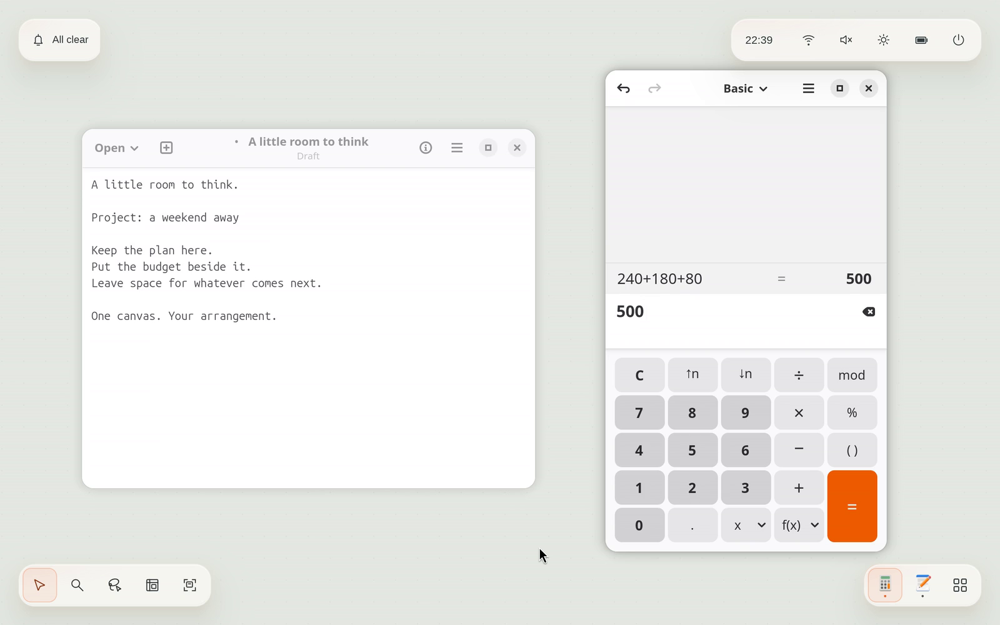

<div align="center">
  
  <h1>Hearthspace</h1>
  <p>A Linux desktop with room for your work.</p>
</div>

Keep your editor beside a terminal. Put your reference material a little farther
to the right. Zoom out to see the whole project, or bring one window forward
and settle in.

Hearthspace gives your applications a continuous canvas. You can move around it,
group related windows, and keep the things you use most attached to the edge of
the screen. Your work has a place, even when it isn't on screen.

[](assets/demo.mp4)

**Hearthspace is becoming a daily driver.** It's in regular hands-on use and
active development. You can try real applications, a configurable desktop,
notifications, and a themed lock screen today. There are still rough edges;
read the [known limits and next steps](docs/ROADMAP.md) and
[tested environments](docs/TESTED_ENVIRONMENTS.md) before making it your only
desktop.

## Make space for a project

Windows can live beyond the edges of your display. Pan to reach them, pinch to
zoom, or search when you don't remember where you put something. The map gives
you a small view of the bigger picture.

Search and the window switcher temporarily bring work together so you can choose
it. Closing them restores your arrangement. You don't have to tidy your desktop
just to find a window.

## Keep familiar things close

The screen's edges form a configurable frame. Attach a reference window, move
your app dock to a side, or group controls into a bar. **Change layout** lets you
decide what stays nearby as you move across the canvas.

The starting arrangement puts notifications at the top left, system controls at
the top right, canvas tools at the bottom left, and apps at the bottom right.
It's a starting point you can make your own.

## Use the apps you already know

Hearthspace runs Linux applications, including Wayland and X11 apps. Browse the
installed catalog, keep favorites in the dock, and return to a running app with
a click. You can also assign a simple drawing to an app and draw it to launch.

Light and dark themes, coordinated accent colors, and photo backgrounds make
the desktop yours. Apps keep their own identities. Optional local AI can help
gather related windows; the rest of the desktop works without a model download.

## Try it

Hearthspace currently builds from source. Ubuntu 26.04 is the documented setup;
see [dependencies](docs/DEPENDENCIES.md) before installing.

From the repository, run:

```sh
scripts/install-session install
```

Run the installer as your normal user. It builds an optimized release, then asks
for administrator access to install it. Log out and select **Hearthspace** at
the login screen. [The installation guide](docs/LOGIN_SESSION.md) covers updates,
removal, and what the installer changes.

Want to explore inside your current desktop first? Follow the
[nested development setup](CONTRIBUTING.md#run-it). That gives you a window to
try the canvas in, with some system features reserved for a full login session.

For your first few minutes:

| Do this | With this |
| --- | --- |
| Open apps | Tap **Super**, or click **Apps List**. |
| Open a terminal | **Super+Return**. |
| Switch windows | **Alt+Tab**; add **Shift** to go backward. |
| Move around the canvas | Slide three fingers, or use **Super+arrow keys**. |
| Zoom | Pinch with three fingers, or use the map's zoom controls. |
| Make the layout yours | Choose **Change layout** in Canvas tools. |

The [first-session guide](docs/GETTING_STARTED.md) introduces the rest, including
mouse and keyboard navigation.

## Help shape it

Reports from real work are especially useful: the app you were using, what you
expected, and what happened instead. [Open an issue](https://github.com/crutchcorn/hearthspace/issues)
for a reproducible problem or a workflow that feels awkward.

Want to contribute code, design, or documentation? Start with
[CONTRIBUTING.md](CONTRIBUTING.md). The [documentation catalog](docs/README.md)
has feature guides and deeper technical explanations.

## License

The code is licensed under [Apache 2.0](LICENSE.md). The Hearthspace name and logo
aren't covered by that license; don't use them to imply endorsement of a
modified version, commercial product, or unrelated project without permission.
